# Desenvolvimento

## Teclado e foco

- [ ] **Exibir indicador de foco visível** em todos os elementos focáveis. (AA)   
- [ ] **Evitar que o elemento em foco fique totalmente escondido** por cabeçalho fixo, banner de cookies ou chat. (AA)   
- [ ] **Manter o elemento em foco completamente visível.** (AAA, Recomendação)   
- [ ] **Garantir ordem de foco lógica** (Tab segue a ordem visual). (A)   
- [ ] **Evitar armadilha de foco:** é possível entrar e sair de todo componente só com teclado. (A)   
- [ ] **Permitir operar toda funcionalidade só pelo teclado**, exceto as que dependem do traçado (desenho à mão livre). (A)   
**Resultado:** Parcial:  
Na home, os títulos dos submenus (“Assuntos”, “Institucional”…) são `<span>`, não focáveis. Se o submenu abre só por hover ou por clique no `<span>`, não dá para abri-lo pelo teclado, a menos que o script adicione `tabindex`.

- [ ] **Tornar toda funcionalidade acessível por teclado, sem exceção.** (AAA, Recomendação)   
- [ ] **Abrir e fechar submenus pelo teclado**, não só por mouseover. (A)   
- [ ] **Permitir desativar ou remapear atalhos de tecla única**, ou fazer com que só funcionem com o componente em foco. (A)   
- [ ] **Manter visível e dispensável (Esc) o conteúdo exibido por hover ou foco** (tooltip, submenu). (AA)   
- [x] **Adicionar link "Pular para o conteúdo"** como primeiro item focável, ou outro mecanismo para contornar blocos repetidos. (A)   
**Resultado:** Home: sim. “Ir ao conteúdo” é o primeiro item e `#main-content` existe no `<main>`. Páginas internas (`/english`, `/espanol`): não, porque `#main-content` não existe e o link não leva a lugar nenhum. Em ambas, o `<base href>` pode fazer o link recarregar a página em vez de pular. Confirme também se o link fica visível ao receber foco, o que depende de CSS que não li.  
  
- [ ] **Dar instruções de uso para componentes customizados** de interação complexa. (A)   
Não se aplica. Os componentes são padrões conhecidos

## Semântica e estrutura do código

!!! note "Itens não avaliados"
    Sete itens desta seção constam do guia, mas não foram avaliados no portal. Eles aparecem como "Não avaliado" e entram na contagem como não cumpridos.

- [x] **Dar a cada página um `<title>` único e descritivo.** (A)   
Resultado: Sim, cada notícia ou aba sim um `<title>` único.  
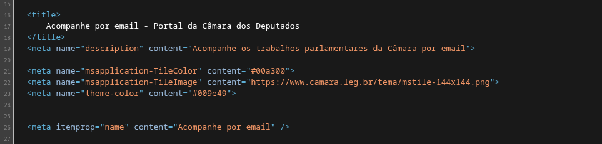  

- [x] **Declarar o idioma da página** (lang="pt-BR"). (A)   
Resultado: Sim, tem o idioma no código fonte do frontend  
  
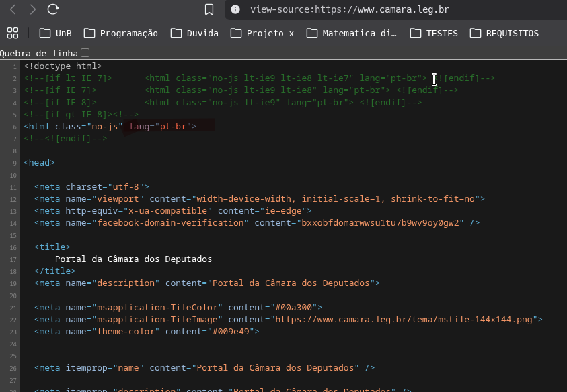  

- [x] **Marcar com lang trechos em outro idioma.** (AA)   
Resultado: O conteúdo não tem `lang="en"` ou `lang="es"`. Os links “English” e “Español” também não têm.  
Versão Inglês:  
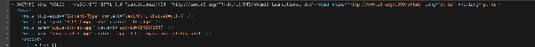  
Versão Espanhol  
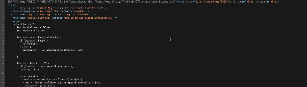  

- [x] **Usar h1 a h6 nos títulos**, não apenas fonte grande ou negrito. (A)   
Resultado: Sim, os títulos usam marcação de cabeçalho (h1 "Página Inicial"; h2 "Serviços", "Notícias", "Agenda" etc.).  
  
- [x] **Manter hierarquia de títulos lógica**, sem pular níveis (h2 para h4). (A)   
Resultado: Sim, a sequência é h1, h2 e h3 (em "Notícias institucionais"), sem saltos.  
  
- [x] **Ter um, e só um, h1** que identificar a página. (AAA, Recomendação)   
Resultado: Sim, há um único h1, "Página Inicial". Ele identifica a página, mas é genérico.

- [x] **Usar regiões** (header, nav, main, footer) de acordo com o conteúdo. (A)   
Resultado: Sim, usa tags semânticas  
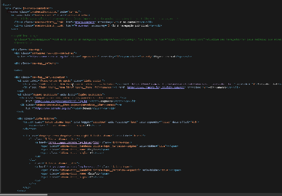  

- [x] **Dar nome acessível único a regiões do mesmo tipo** (ex.: dois nav com aria-label diferentes). (A)   
Resultado: Sim, tudo tem o mesmo nome acessível na mesmo tipo, exemplo:  
  
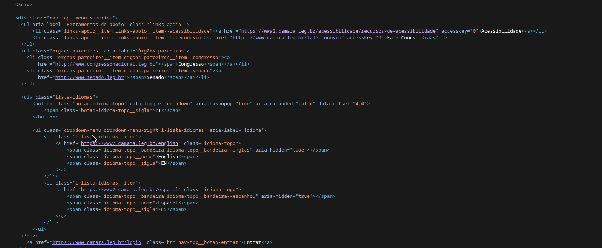  

- [x] **Colocar todo o conteúdo em regiões**, com no máximo um header, um main e um footer. (AAA, Recomendação)   
Resultado: Sim, tudo segue a sequência como esse exemplo:  

```html
  <body>
    <header>
      <h1>Cabeçalho Principal</h1>
      <nav>
        <ul>
          <li><a href="#">Início</a></li>
          <li><a href="#">Sobre</a></li>
          <li><a href="#">Contato</a></li>
        </ul>
      </nav>
    </header>

    <main>
      <section>
        <h2>Seção de Conteúdo</h2>
        <p>Este é um parágrafo de exemplo no corpo do site.</p>
      </section>
    </main>

    <footer>
      <p>&copy; 2026 - Todos os direitos reservados.</p>
    </footer>
  </body>
```

- [x] **Usar ul, ol ou dl para listas** de itens da mesma natureza. (A)   
Resultado: Sim, menu, serviços, agenda, rodapé e redes sociais estão estruturados como listas.  
  
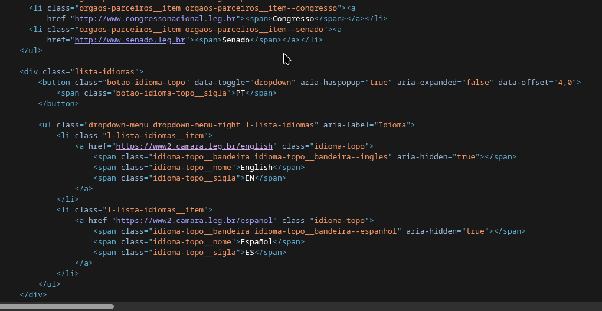  

- [ ] **Marcar tabelas de dados com table, th e scope** e não usar tabela para leiaute. (A)   
  
Não, pois não tem tabelas no site. Logo não se aplica  
  
- [ ] **Associar um título (caption) a cada tabela.** (A)   
Não, pois não tem tabelas no site. Logo não se aplica  

- [x] **Manter a ordem do código (DOM) igual à ordem visual.** (A)   
Resultado: Sim, o conteúdo segue a mesma sequência da exibição na tela.  
  
  
- [ ] **Preferir elementos nativos** (button, a, input) a div com clique. (A, Recomendação)
Resultado: Não avaliado.

- [ ] **Expor função, estado e valor de componentes customizados** (role, aria-expanded, aria-checked). (A)
Resultado: Não avaliado.

- [ ] **Dar nome acessível a todo componente que precisa de nome**, contendo o texto visível. (A)
Resultado: Não avaliado.

- [ ] **Anunciar mensagens de status sem mover o foco** (role="status" ou aria-live). (AA)
Resultado: Não avaliado.

- [ ] **Dar title único a todo iframe.** (A)
Resultado: Não avaliado.

- [x] **Não bloquear o zoom** (sem user-scalable=no ou maximum-scale=1). (AA)   
Resultado: Sim, o viewport é width=device-width, initial-scale=1, shrink-to-fit=no, sem bloqueio de zoom.  


- [ ] **Marcar ênfase, citação e abreviação** com strong, em, blockquote, abbr. (A)
Resultado: Não avaliado.

- [ ] **Não inserir conteúdo relevante só por CSS** (::before) nem escondê-lo do leitor de tela com display:none. (Boa prática)
Resultado: Não avaliado.

## Imagens (implementação)

- [x] **Adicionar alt que descreve a informação** em imagens de conteúdo. (A)   
Resultado: Sim, toda imagem tem um alt, mas não são muitos descritivos e são usados somente em imagens.   

```html
<article class="noticia-institucional">
    <figure class="noticia-institucional__imagem-container">
        
    </figure>
    <div class="noticia-institucional__conteudo">
        <div class="noticia-institucional__retranca">
            diálogo
        </div>
        <p class="noticia-institucional__texto">
            <a href="https://www.camara.leg.br/assessoria-de-imprensa/1315634-entre-casas-reune-servidores-de-parlamentos-brasileiros-em-brasilia-para-trocar-experiencias-e-fortalecer-redes" class="noticia-institucional__link">
                Entre Casas reúne servidores de parlamentos brasileiros
            </a>
        </p>
    </div>
</article>
```

- [ ] **Adicionar alt que descreve a ação ou o destino** em imagens funcionais (ícone em link ou botão). (A)   
- [ ] **Usar alt="" ou CSS em imagens decorativas.** (A)   
- [ ] **Dar descrição detalhada a imagens complexas** (gráficos, infográficos), ao lado ou em página indicada. (A)   
- [ ] **Evitar imagens de texto**, salvo as essenciais (logotipo). (AA)   
- [ ] **Adicionar texto alternativo em cada área de mapas de imagem.** (A) 

## Links e navegação

- [x] **Usar `<a href>` para navegar e `<button>` para ações.** (A)   
Resultado: Sim, esse é o padrão em todo o site.  
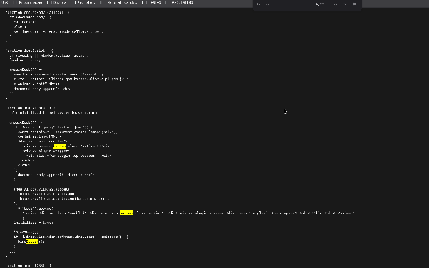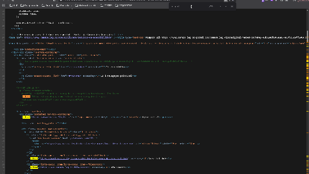  

- [ ] **Deixar claro o propósito do link** pelo texto ou pelo contexto (sem "clique aqui" isolado). (A)   
- [ ] **Deixar claro o propósito do link só pelo texto do link.** (AAA, Recomendação)   
- [x] **Levar ao mesmo destino links com o mesmo texto.** (AA, Recomendação)   
Resultado: Sim na página inicial como exemplo, pois links repetidos como "Agenda" e "Notícias" levam ao mesmo destino.  
  
  
- [ ] **Avisar quando o link abre nova aba, baixar arquivo (formato e tamanho) ou leva a site externo.** (AAA, Recomendação)   
Resultado: Não há uma quantidade substancial para verificar pois não tem muitos links que levam a site externos. Porém os que foi encontrado, tinha avisando. Exemplo:

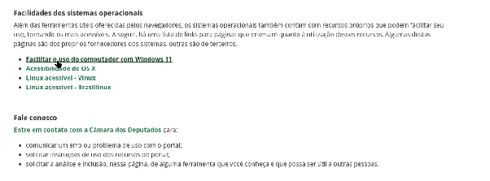   

- [x] **Oferecer mais de uma forma de chegar a cada página** (menu, busca, mapa do site). (AA)   
Resultado: Sim, o portal oferece menu principal e campo de busca ("Pesquise no Portal").  
  
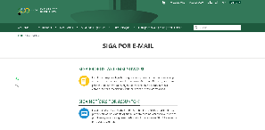  
  
- [x] **Manter a navegação repetida na mesma ordem** em todas as páginas. (AA)   
Resultado: Sim, a navagação é sempre a mesma.  
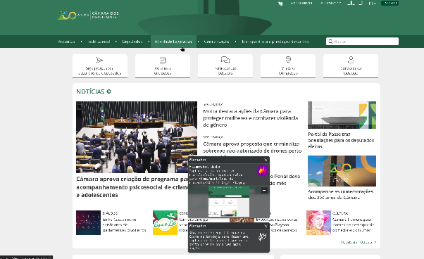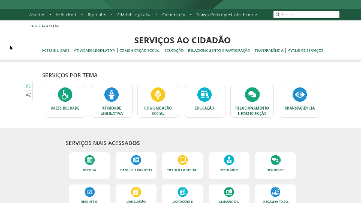  

- [x] **Manter ajuda (contato, FAQ, chat) na mesma posição** em todas as páginas. (A)   
Resultado: Sim na página inicial: "Fale Conosco" no cabeçalho e canais de atendimento (Disque-Câmara e WhatsApp) no rodapé. Confirmar nas páginas internas.  
  
  
- [x] **Indicar onde o usuário está** (breadcrumb, item de menu ativo). (AAA, Recomendação)   
Resultado: Sim, toda página tem o indicativo de onde está  o usuário.  
  
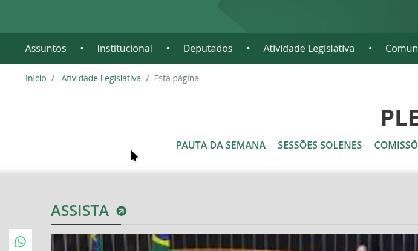

## Botões e controles

- [x] **Dar a todo botão texto ou nome acessível** que indica a função (inclusive botões só de ícone). (A)  
Resultado: Sim, todos os botões têm nomes acessíveis   

- [x] **Usar o mesmo nome para componentes com a mesma função** em todas as páginas. (AA)   
Resultado: Sim, todos os botões têm os mesmos nomes, um exemplo na imagem abaixo   
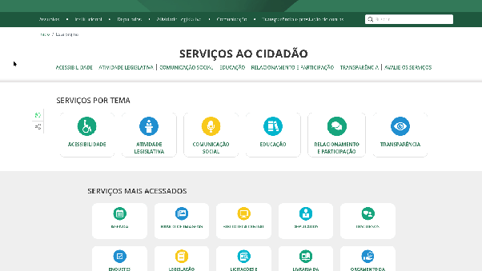  

- [x] Não mudar o contexto ao receber foco ou hover. (A)

**Resultado:** Sim. Ao navegar com Tab e passar o mouse pelos menus da página inicial, o foco ficou visível e os submenus apareceram sem mudar de página. O teste foi feito apenas nessas interações.

- [x] Não mudar o contexto ao alterar um campo ou select sem aviso prévio. (A)

**Resultado:** Sim. No campo testado, mudar a opção não redirecionou a página nem alterou o contexto sem aviso. Os outros campos não foram avaliados.

- [x] Disparar ações ao soltar o ponteiro, com possibilidade de cancelar. (A)

**Resultado:** Sim. Ao pressionar um controle, arrastar o mouse para fora e soltar, a ação foi cancelada. O comportamento foi confirmado nesse controle.

- [ ] Oferecer alternativa de toque simples a gestos com vários dedos ou de traçado. (A)

**Resultado:** Nos testes pelo celular, foi possível usar as funções com toques simples, sem gestos com vários dedos. Não encontramos uma função que exigisse gestos mais complexos nas páginas avaliadas.

- [ ] Oferecer alternativa sem arrastar a toda ação de arrastar (slider, reordenar, mapa). (AA)

**Resultado:** Não encontramos ações que exigissem arrastar objetos. Na agenda de Agropecuária, por exemplo, foi possível rolar os eventos com a rodinha do mouse. Isso não confirma o comportamento de outras funções de arrastar.

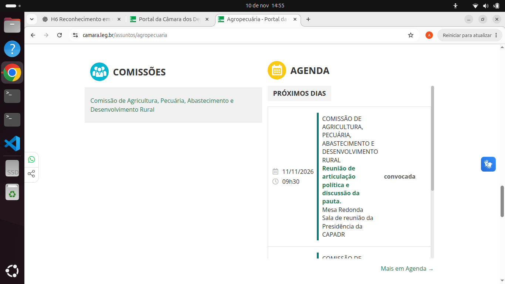

- [ ] Oferecer alternativa a funções por movimento do aparelho e permitir desativá-las. (A)

**Resultado:** Nas páginas testadas pelo celular, nenhuma função exigiu inclinar ou sacudir o aparelho. Por isso, não foi possível avaliar uma alternativa para esse tipo de interação.

- [x] Dar retorno perceptível quando um controle é acionado. (AA, Recomendação)

**Resultado:** Sim. Ao abrir e fechar o menu principal, a página mostrou claramente a mudança. Não testamos a confirmação de envio do formulário de reclamação porque ela exige login no Gov.br.

## Formulários

- [x] Adicionar rótulo visível a todo campo (placeholder não substitui rótulo). (A)

**Resultado:** Sim. No formulário Autenticação de Margem, os campos CPF, Número da Reserva e Data da Geração têm rótulos visíveis, mesmo quando selecionados. A análise ficou restrita a esse formulário.

- [x] Associar o label ao campo (for + id). (A)

**Resultado:** Sim. Pelo DevTools, verificamos que o rótulo do CPF usa `<label for="txtCpf">` e está associado ao campo `<input id="txtCpf">`. Não conferimos essa ligação nos demais campos.

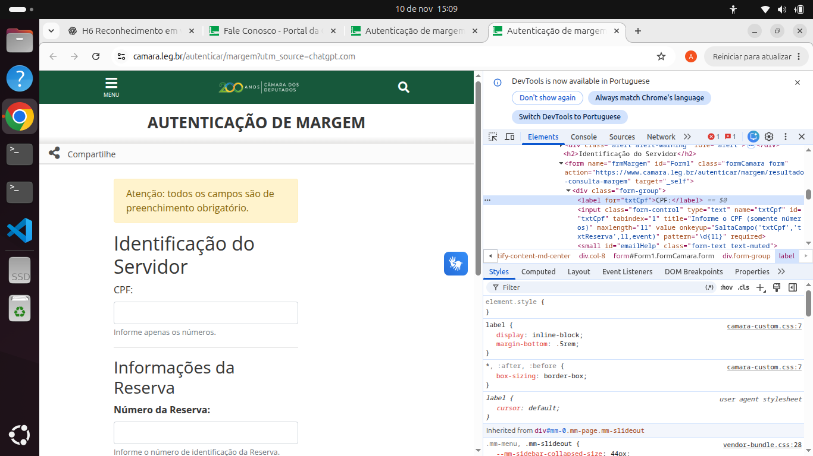

- [x] Escrever rótulos e textos de ajuda descritivos, em posição previsível. (AA)

**Resultado:** Sim. Na página Autenticação de Margem, as orientações aparecem junto dos campos: o CPF pede apenas números, a reserva pede seu número de identificação e a data informa o formato dd/mm/aaaa.

- [ ] Agrupar campos relacionados com fieldset e legend. (A)

**Resultado:** Não. No formulário Autenticação de Margem, não encontramos a tag fieldset pelo DevTools. Existem divisões visuais, como “Identificação do Servidor”, mas não o agrupamento semântico com fieldset e legend.

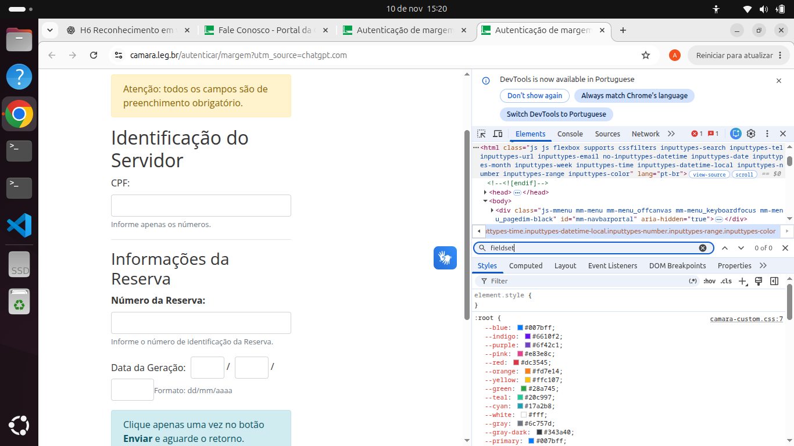

- [x] Indicar campos obrigatórios em texto ou símbolo explicado, não só por cor. (A)

**Resultado:** Sim. Antes dos campos da Autenticação de Margem, há o aviso “Atenção: todos os campos são de preenchimento obrigatório”. Assim, a informação não depende apenas de cor.

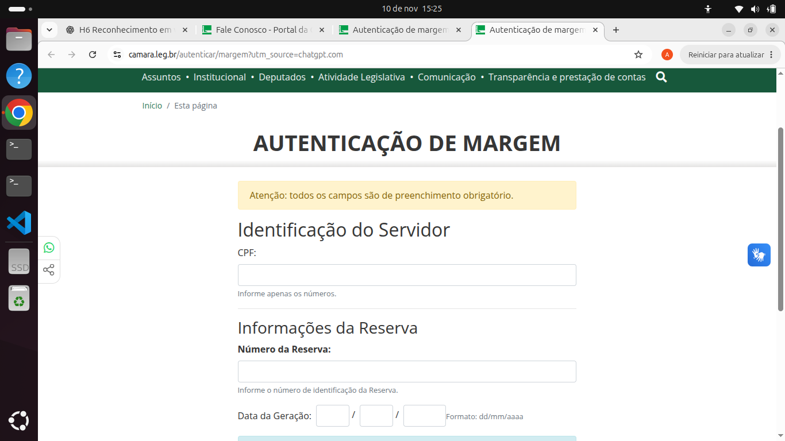

- [ ] Adicionar autocomplete e tipo correto em campos de dados pessoais. (AA)

**Resultado:** Parcial. O campo CPF usa type="text", `pattern="\d{11}"` e maxlength="11", mas não encontramos autocomplete nem inputmode. Isso não basta, por si só, para afirmar uma falha de autocomplete, já que não há um valor padronizado específico para CPF.

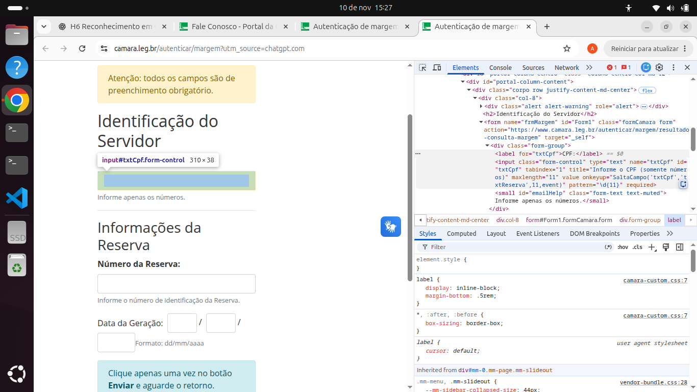

- [ ] Exibir mensagem de erro em texto que diz qual é o erro e o campo, perto dele e anunciada pelo leitor de tela. (A)

**Resultado:** Parcial. Ao tentar enviar o CPF em branco, apareceu a mensagem “Preencha este campo.” perto dele, e o foco foi levado até o campo. Não testamos se um leitor de tela anuncia o erro, nem a mensagem identifica o CPF pelo nome.

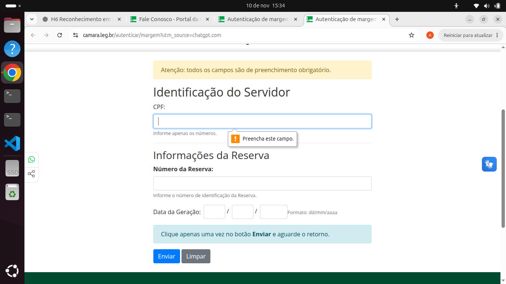

- [ ] Sugerir a correção na mensagem de erro (ex.: "Use o formato DD/MM/AAAA"). (AA)

**Resultado:** Parcial. Ao informar “123” no CPF, apareceu um aviso sobre o formato e a orientação para usar apenas números. Porém, a mensagem não explica que o CPF precisa ter 11 dígitos.

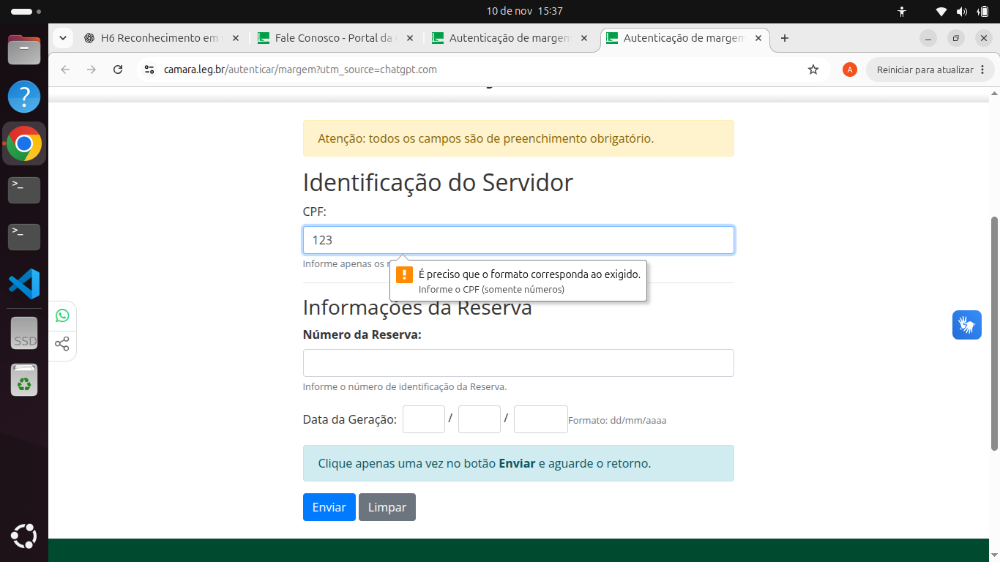

- [ ] Permitir revisar, confirmar ou desfazer formulários críticos (pagamento, dados jurídicos, exclusão). (AA)

**Resultado:** Não foi possível avaliar. Nas páginas visitadas, não encontramos formulários de pagamento, exclusão ou outra operação crítica para testar etapas de revisão e confirmação.

- [ ] Permitir revisar, confirmar ou desfazer todo formulário. (AAA, Recomendação)

**Resultado:** Parcial. Na Autenticação de Margem, vimos os botões “Enviar” e “Limpar”, mas nenhuma revisão antes do envio. Como não concluímos um envio real, não sabemos se aparece uma confirmação depois.

- [ ] Não pedir de novo dados já informados no mesmo processo, ou trazê-los preenchidos. (A)

**Resultado:** Não houve repetição de dados no formulário testado. A Autenticação de Margem tem uma única etapa, com CPF, Número da Reserva e Data da Geração. Não avaliamos processos mais longos.

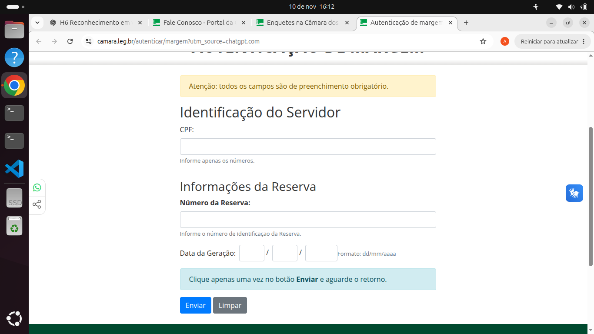

- [x] Não exigir teste cognitivo no login: permitir colar senha e usar gerenciador de senhas, ou oferecer alternativa. (AA)

**Resultado:** Sim, no teste realizado. O portal oferece entrada pelo Gov.br e um formulário de e-mail e senha para pessoa jurídica ou estrangeiro. Conseguimos colar uma senha fictícia nesse campo; o uso de gerenciadores de senha não foi testado.

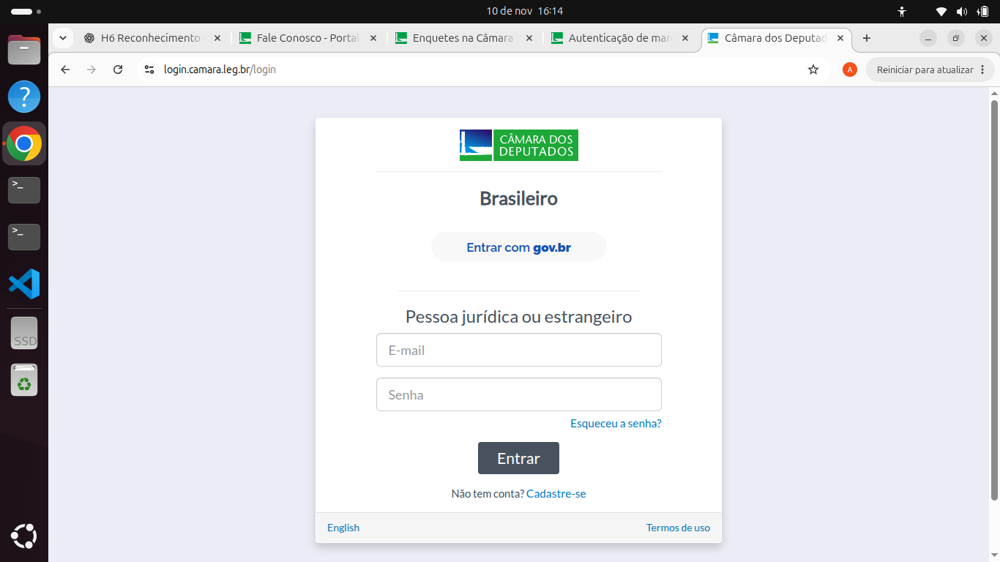

- [x] Identificar o CAPTCHA e oferecer alternativa em outra modalidade. (A)

**Resultado:** Não apareceu CAPTCHA nas opções de login que analisamos. Portanto, não encontramos essa barreira, mas também não foi possível verificar se haveria outra forma de resolver um CAPTCHA caso ele surgisse.

- [x] Oferecer ajuda contextual (instruções e exemplos) para preencher. (AAA, Recomendação)

**Resultado:** Sim. Na Autenticação de Margem, os campos trazem dicas úteis, como usar apenas números no CPF e preencher a data no formato dd/mm/aaaa. A avaliação foi feita nesse formulário.

- [x] Incluir botão de envio explícito em todo formulário. (A, Recomendação)

**Resultado:** Sim. O formulário Autenticação de Margem tem um botão “Enviar” bem visível, separado do “Limpar”, além da orientação para clicar uma vez e aguardar. Não analisamos todos os formulários do site.

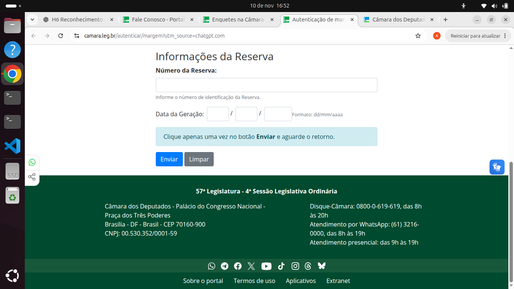

## Tempo, movimento e modais

- [ ] Permitir desligar, ajustar ou estender limites de tempo antes de expirarem. (A)

**Resultado:** Não foi possível avaliar. No formulário Autenticação de Margem, não encontramos contador, prazo para preenchimento ou aviso de sessão prestes a expirar.

- [ ] Permitir pausar, parar ou ocultar animações automáticas com mais de 5 s (carrossel, banner). (A)

**Resultado:** Não foi possível avaliar. Durante a análise da página inicial, não vimos carrosséis ou banners se movendo automaticamente por mais de cinco segundos.

- [ ] Permitir pausar ou controlar atualizações automáticas de conteúdo. (A)

**Resultado:** Não foi possível avaliar. Notícias, agenda e a seção ACOMPANHE não apresentaram atualizações automáticas durante o teste. Esse recurso pode existir em outras páginas.

- [ ] Permitir pausar ou silenciar áudio que toca sozinho por mais de 3 s. (A)

**Resultado:** Não foi possível avaliar. Na seção ACOMPANHE, o vídeo do Plenário não começou a tocar sozinho; era preciso apertar o botão de reprodução. Assim, não houve áudio automático para testar.

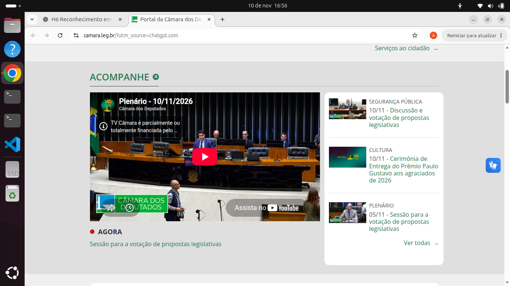

- [x] Evitar conteúdo que pisca mais de 3 vezes por segundo. (A)

**Resultado:** Sim, nas páginas observadas. Não vimos flashes ou elementos piscando rapidamente, embora não tenha sido feita uma medição técnica da frequência das piscadas.

- [ ] Evitar perda de dados quando a sessão expira, ou avisar antes. (AAA, Recomendação)

**Resultado:** Não verificado. Não acompanhamos uma sessão com login até expirar, então não foi possível saber se o site avisa antes ou preserva os dados preenchidos.

- [ ] Controlar o foco em modais: entra no modal, fica nele enquanto aberto, fecha com Esc e com botão rotulado, volta ao gatilho. (Boa prática)

**Resultado:** Parcial. No teste com teclado, o menu abriu, fechou com Esc e devolveu o foco ao item anterior. Porém, como o elemento testado era um menu suspenso e não um modal, não dá para confirmar os requisitos específicos de janelas modais.

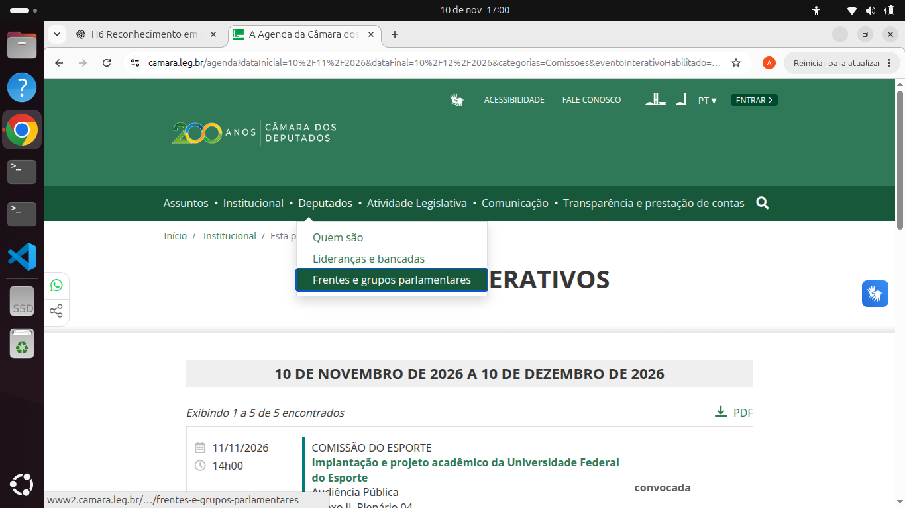

- [x] Não abrir modais sozinhos, nem a partir de outro modal, nem em tela cheia. (Boa prática)

**Resultado:** Sim, nas interações observadas. As janelas analisadas só abriram após uma ação do usuário, sem abrir outra por cima ou ocupar a tela inteira. Não testamos todos os diálogos do portal.

Itens cumpridos: 36 de 80.
