# Design

A seção de Design reúne itens que verificam o que o usuário consegue ver na tela. Ela se divide em quatro blocos. Cor e contraste exige que nenhuma informação dependa só da cor e que textos, ícones, bordas de controles e o indicador de foco tenham contraste mínimo. Tipografia e texto na tela verifica se o conteúdo continua legível com zoom e espaçamento ajustado, sem cortes ou sobreposições, além de boas práticas aplicadas. Leiaute e interação avalia a capacidade de adaptação da página às diferentes telas e às orientações retrato e paisagem e se botões e links funcionam corretamente. A animação confere se movimentos automáticos podem ser desativados, respeitando a preferência prefers-reduced-motion, e se nada pisca em excesso.

## Cor e contraste

- [x] Adicionar informação que não dependa exclusivamente da cor. (A)

Resultado: Sim, é possível identificar a informação dos campos dentro do site, sem depender da cor.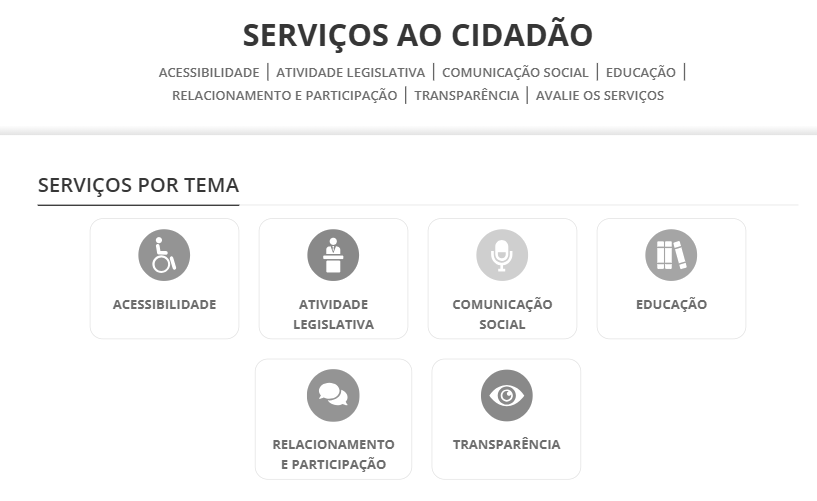

Fonte: elaborado pelo autor (2026)

- [x] Distinguir links no meio do texto por algo além da cor (ex.: sublinhado). (A)

Resultado: Sim, os links possuem um sublinhado para a sua identificação ao passar o mouse por cima do texto.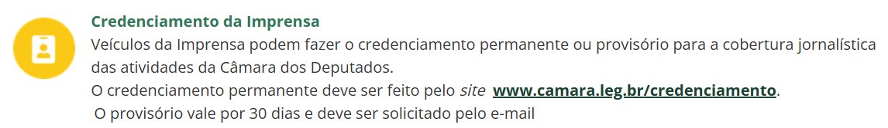

Fonte: elaborado pelo autor (2026)

- [x] Escrever instruções que não dependam só de forma, cor, tamanho, posição ou som. (A)

Resultado: Sim, as instruções são identificadas e informadas não só pela posição, tamanho ou cor, elas explicam o que deve ser feito em texto.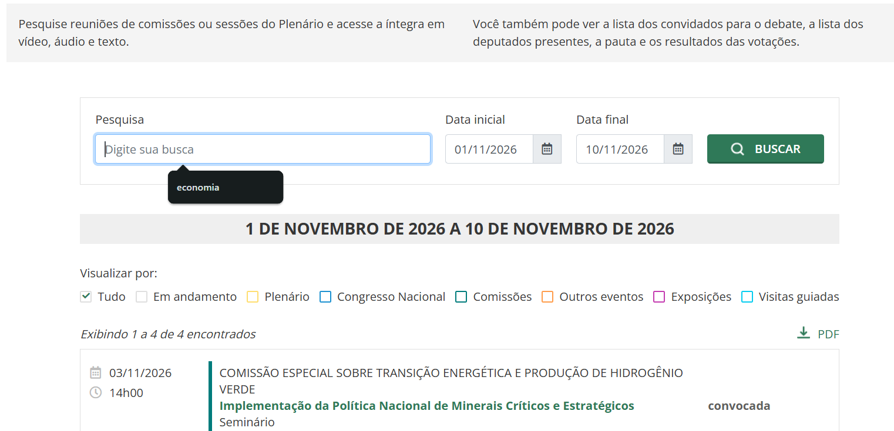

Fonte: elaborado pelo autor (2026)

- [x] Garantir contraste de texto de pelo menos 4,5:1. (AA)

Resultado: Sim, o contraste de texto mínimo encontrado foi de 5.25.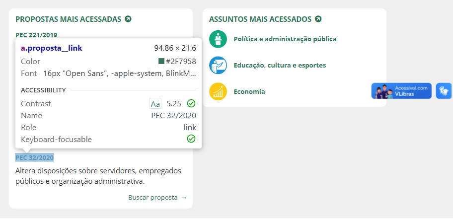

Fonte: elaborado pelo autor (2026)

- [ ] Garantir contraste de texto aprimorado de 7:1 (AAA, Recomendação)

Resultado: Não, o contraste de texto mínimo registrado foi de 5,25 portanto não chega a cumprir com este ponto.

- [ ] Garantir contraste de 3:1 em bordas de campos, botões e seus estados. (AA)

Resultado: Não, a borda e o fundo têm um contraste baixo, mas para compensar, os controles são identificados pelo texto do rótulo.

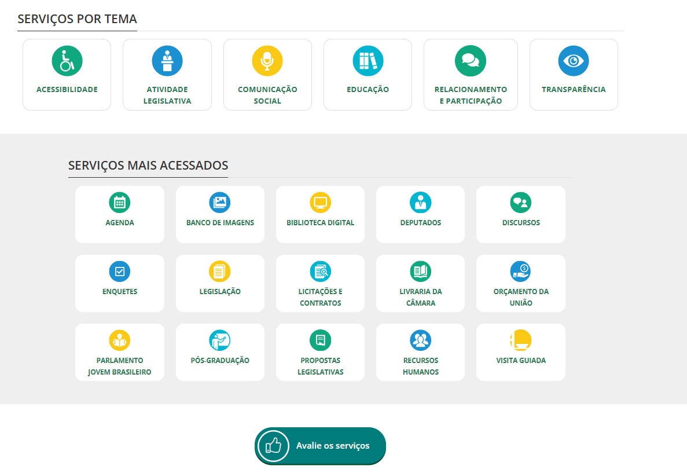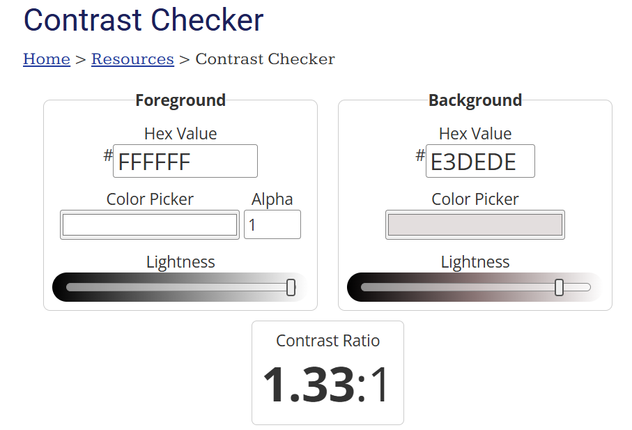

Fonte: WebAIM Contrast Checker           Fonte: elaborado pelo autor (2026)

- [ ] Garantir contraste de 3:1 em ícones e partes de gráficos. (AA)

Resultado: Não, pois o contraste entre o branco e os ícones amarelos é baixo, porém cada ícone vem acompanhado de um rótulo em texto que ajuda a identificar os campos.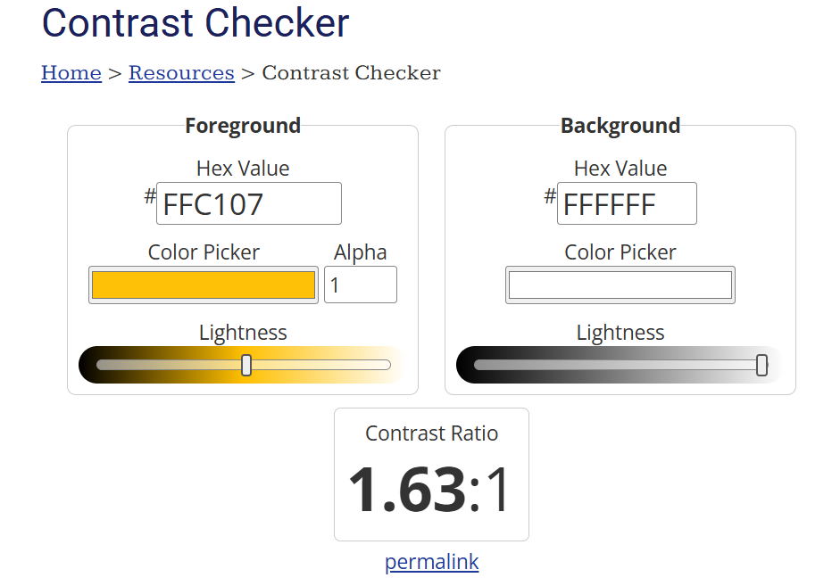

Fonte: WebAIM Contrast Checker

- [ ] Garantir contraste de 3:1 no indicador de foco, com o fundo e com o estado sem foco. (AA)

Resultado: Não, nos campos da barra de navegação para indicar foco, acontece uma mudança de fundo de tons de verde que não têm um contraste alto o suficiente. Apesar disso, o contorno mantém um contraste forte entre a cor do campo e do fundo na maioria dos casos.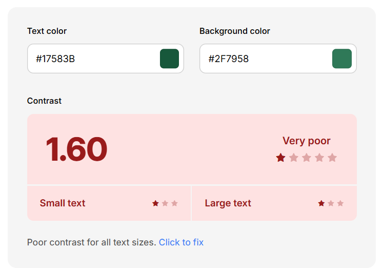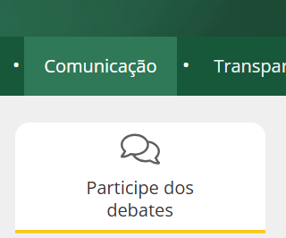

Fonte: Color Contrast Checker           Fonte: elaborado pelo autor (2026)

- [ ] Usar indicador de foco com área de pelo menos o perímetro do elemento e 2 px de espessura. (AAA, Recomendação)

Resultado: Não, pois o indicador de foco não consegue incluir toda a área clicável do elemento.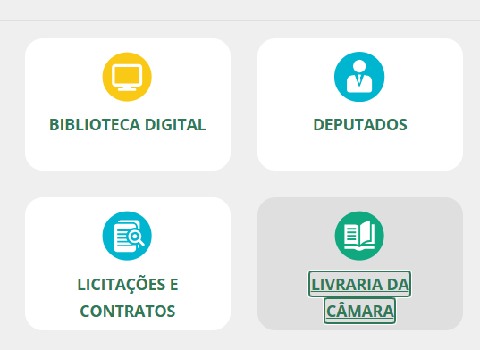

Fonte: elaborado pelo autor (2026)

- [x] Manter o contraste de texto sobre imagem ou degradê. (AA)

Resultado: Sim, a página mantém o contraste recomendado do texto sobre imagem.

## Tipografia e texto na tela

- [ ] Tamanho do texto ajustável: com zoom de 200% não há perda de conteúdo nem sobreposição. (AA)

Resultado: Não, ao aplicar zoom de 200% teve uma sobreposição no menu de navegação.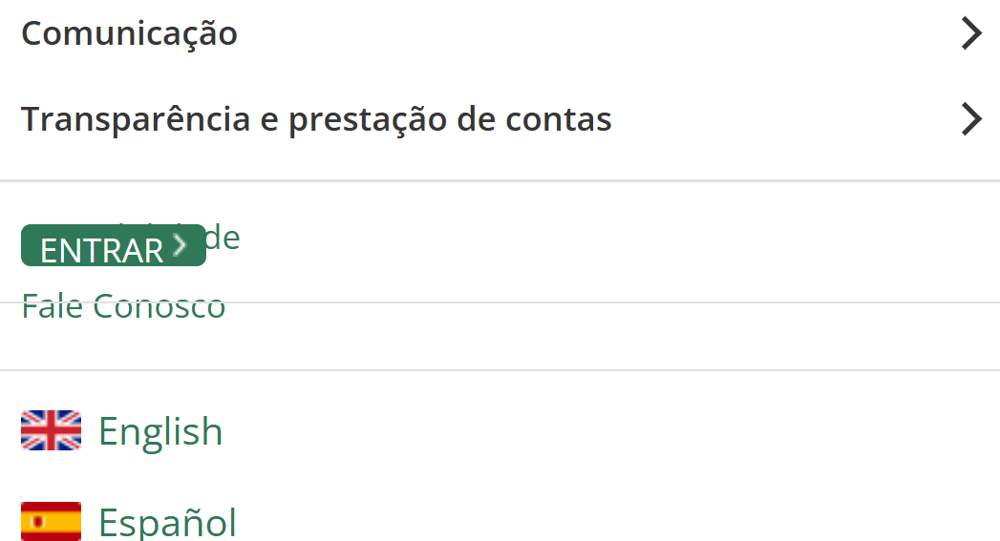

Fonte: elaborado pelo autor (2026)

- [ ] Suportar espaçamento ajustado (entrelinha 1,5×, parágrafo 2×, letras 0,12×, palavras 0,16×) sem cortar texto. (AA)

Resultado: Não cumpre, ao aplicar o espaçamento ajustado pelo Text Spacing Bookmarklet, o texto do card “Siga propostas, assuntos ou deputados”, na página inicial, ultrapassa os limites do card, a linha verde inferior passa a sobrepor o texto e a última palavra fica fora do componente.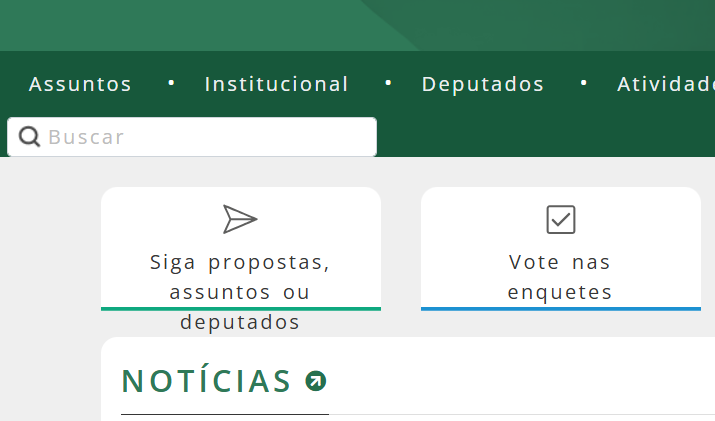

Fonte: elaborado pelo autor (2026)

- [x] Parágrafos com no máximo 80 caracteres por linha, ou largura ajustável. (AAA)

Resultado: Sim, utilizando a largura ajustável, é possível manter todos os parágrafos com no máximo 80 caracteres por linha.

- [x] Evitar o alinhamento justificado; alinhar à esquerda. (AAA, Recomendação)

Resultado: Sim, o texto da página está alinhado à esquerda, seguindo a recomendação.

- [x] Fontes são fluidas e de fácil entendimento, sem textos longos em caixa alta, condensados ou manuscritos. (Boa prática)

Resultado: Sim, a fonte utilizada é a Open Sans e considerou-se que caixa alta deveria ser utilizada em rótulos curtos e não em textos com mais de uma linha. Portanto, o site cumpriu com o item.

- [x] Não reduzir a fonte padrão abaixo da do navegador (16 px). (Boa prática)

Resultado: Sim, a fonte padrão permanece em 16px.

## Leiaute e interação

- [x] Fazer com que as linhas se ajustem ao viewport: com 320 px de largura não há rolagem horizontal nem perda de conteúdo. (AA)

Resultado: Sim, as linhas se ajustam conforme a largura da página varia o seu tamanho.

- [x] Funcionar em retrato e em paisagem. (AA)

Resultado: Sim, o site foi aberto em um dispositivo móvel em modo retrato e em paisagem, verificando que o conteúdo me mantém funcional.

- [x] Elementos interativos têm pelo menos 24×24 px ou espaçamento suficiente, ou estão no texto, têm controle equivalente maior, ou o tamanho é essencial, legal ou definido pelo navegador. (AA)

Resultado: Sim, os elementos interativos possuem um tamanho maior do que 24x24 px.

- [ ] Áreas clicáveis têm pelo menos 44×44 px. (AAA, Recomendação)

Resultado: Não cumpre, tem áreas clicáveis menores do que 44x44 px.

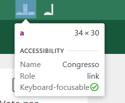

Fonte: elaborado pelo autor (2026)

- [x] Botões parecem botões e links parecem links, de acordo com a função. (Boa prática)

Resultado: Sim, os botões e links seguem um formato específico para serem identificados pelos usuários.

- [x] Evitar excesso de informação e manter busca e menu sempre no mesmo lugar. (Boa prática)

Resultado: Sim, o campo de busca e o menu não mudam de lugar, as informações são organizadas e não excessivas.

- [x] Preferir botões com texto e ícone; botões apenas com ícone têm nome acessível. (Boa prática)

Resultado: Sim, os botões que não possuem texto apresentam o nome no lado esquerdo inferior.

- [ ] Oferecer opção de alto contraste (modo escuro) e aumento de fonte. (Boa prática, não obrigatória)

Resultado: Não cumpre, mas com ajuda da extensão High Contrast do Google Chrome é possível aplicar alto contraste no site.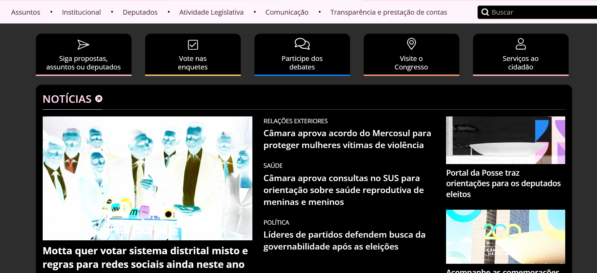

Fonte: elaborado pelo autor (2026)

## Animação

- [ ] Permitir desativar animações disparadas pela interação (parallax, zoom ao rolar), respeitando prefers-reduced-motion. (AAA, Recomendação)

Resultado: Não, foi aplicado o emulate prefers-reduced-motion do Devtools dentro do site mas as animações não mudaram de comportamento.

- [x] Não ter conteúdo que pisque mais de 3 vezes em qualquer período de 1 s. (AAA, Recomendação)

Resultado: Sim, não há conteúdo dentro do site que pisque mais de 3 vezes em qualquer período de 1s.

- [x] Usar animações só quando necessárias, sem tela cheia e funcionando em velocidade reduzida. (Boa prática)

Resultado: Sim, não houve animações em tela cheia e as animações presentes continuam acessíveis a 10% da velocidade.

Itens cumpridos: 17 de 27.