# Geração de Conteúdo

A seção de Geração de Conteúdo reúne itens que verificam o que é publicado no site: textos, descrições de imagens, vídeos, áudios e arquivos. Ela parte do princípio de que mesmo que um site contenha código e design acessíveis, ainda pode excluir pessoas se o conteúdo não for pensado para todos. Divide-se em quatro blocos, cada um deles contendo itens que atendem principalmente pessoas surdas, cegas, com deficiência, neurodivergentes e com baixo letramento digital.

## Texto e linguagem

- [x] Escrever títulos e rótulos que descrevem o tema ou o propósito. (AA)

Resultado: Sim, utilizando a extensão de HeadingsMap do Google foi verificado que os títulos e rótulos descrevem os temas ou propósitos presentes no site de forma correta.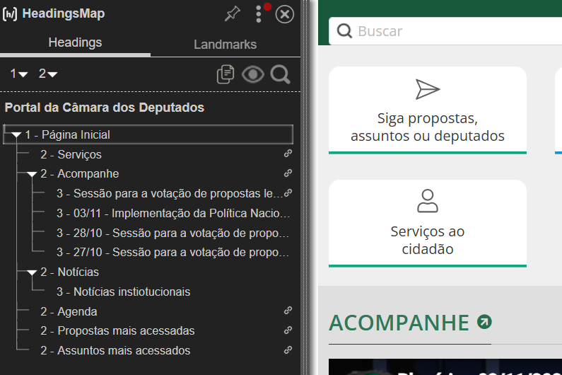

Fonte: elaborado pelo autor (2026)

- [ ] Usar linguagem simples, frases curtas (15 a 20 palavras) e ordem direta. (AAA, Recomendação)

Resultado: Não cumpre, dentro da seção de propostas analisadas o texto não aplica uma linguagem simples.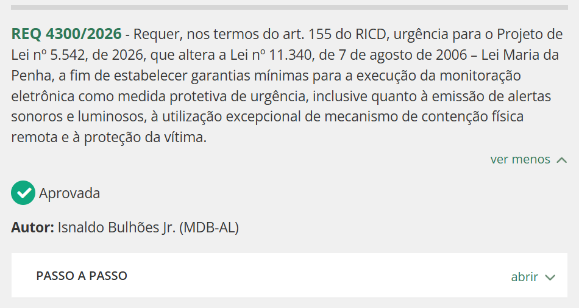

Fonte: elaborado pelo autor (2026)

- [x] Explicar jargões, termos técnicos e expressões idiomáticas. (AAA, Recomendação)

Resultado: Sim, os termos técnicos dos textos encontrados dentro da página possuem uma explicação de apoio.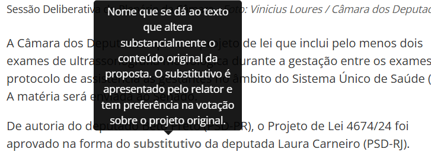

Fonte: elaborado pelo autor (2026)

- [ ] Escrever siglas por extenso na primeira vez. (AAA, Recomendação)

Resultado: Sim, as siglas são escritas de forma completa para compreensão do usuário.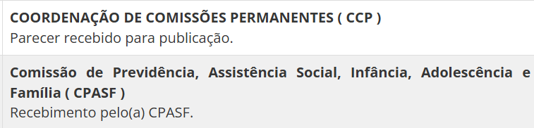

Fonte: elaborado pelo autor (2026)

- [x] Indicar a pronúncia de palavras ambíguas no contexto. (AAA, Recomendação)

Resultado: Sim, apesar de não haver indicadores de pronúncia, foram verificados títulos e textos como amostra dentro da página e foi verificado que nesses casos o contexto define o sentido e a pronúncia.

- [x] Escrever links que dizem o destino ou a ação ("Baixe o relatório 2025 (PDF, 2 MB)", não "baixar PDF"). (A)

Resultado: Sim, os links disponíveis possuem texto que deixa específico o destino ou ação a ser realizada.

- [x] Usar o termo "pessoa com deficiência". (Boa prática)

Resultado: Sim, a página utiliza de forma correta o termo “pessoa com deficiência”, evitando termos antigos ou pejorativos.

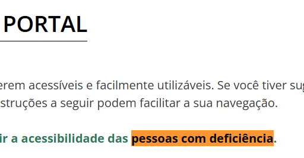

Fonte: elaborado pelo autor (2026)

- [x] Usar pontuação correta e evitar senso de urgência e figuras de linguagem desnecessárias. (Boa prática)

Resultado: Sim, foram analisados textos de amostra, comprovando que têm pontuação adequada e uso de tom neutro, também não foram encontradas chamadas com senso de urgência.

- [x] Escrever hashtags com maiúscula em cada palavra (#AcessibilidadeDigital) e usar emojis com moderação. (Boa prática)

Resultado: Sim, hashtags e emojis não foram encontrados dentro das páginas avaliadas.

## Imagens (descrição)

- [ ] Descrever no texto alternativo o tipo de imagem, o quê ou quem aparece, onde e a ação, no presente. (A)

Resultado: Não cumpre, apesar de haver imagens com texto alternativo disponível, existem imagens que não possuem texto alternativo (alt=""). A ferramenta de apoio utilizada foi a Wave Evaluation Tool.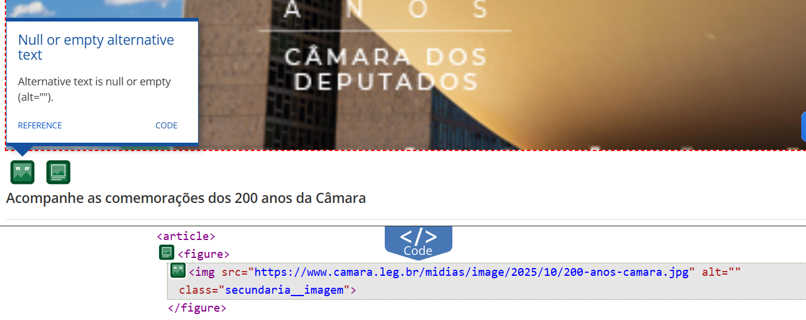

Fonte: elaborado pelo autor (2026)

- [ ] Evitar no alt "a foto mostra", repetição do texto ao lado e juízo de valor. (Boa prática)

Resultado: Não, as descrições do texto alternativo estão corretas, mas podemos encontrar um caso onde várias imagens têm o mesmo texto alternativo. A ferramenta de apoio utilizada foi a Wave Evaluation Tool.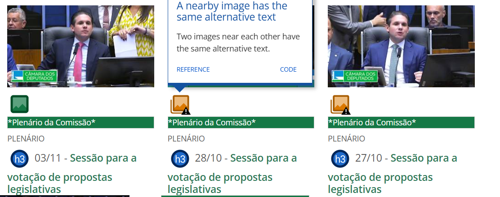

Fonte: elaborado pelo autor (2026)

- [ ] Dar alt curto e descrição longa fora do alt para gráficos e infográficos. (A)

Resultado: Não, as imagens possuem um alt curto, mas não têm descrição longa complementar fora do alt.

- [x] Publicar avisos, cartazes e banners como texto, não como imagem de texto. (AA)

Resultado: Sim, os avisos, cartazes e banner disponíveis estão em formato de texto.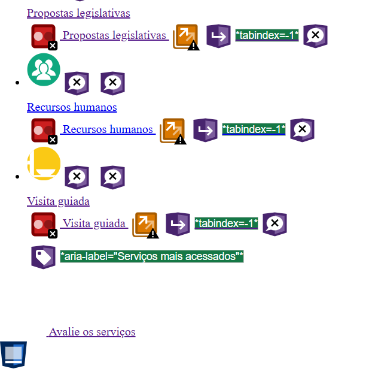

Fonte: elaborado pelo autor (2026)

## Vídeo e áudio

- [x] Adicionar transcrição a áudio pré-gravado. (A)

Resultado: Sim, os áudios pré-gravados na seção de Rádio Câmara dispõem de transcrição.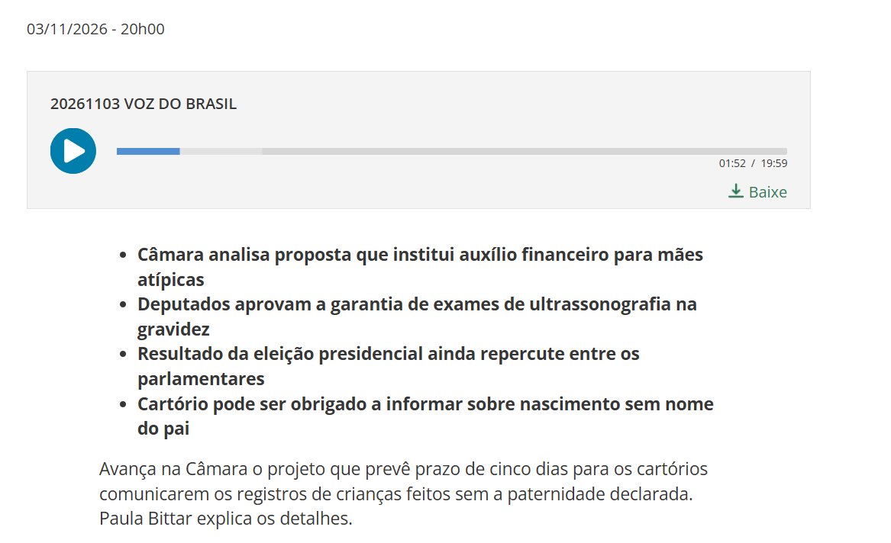

Fonte: elaborado pelo autor (2026)

- [ ] Adicionar legendas descritivas a vídeo pré-gravado. (A)

Resultado: Não cumpre, os vídeos pré-gravados não apresentam função de legendas.

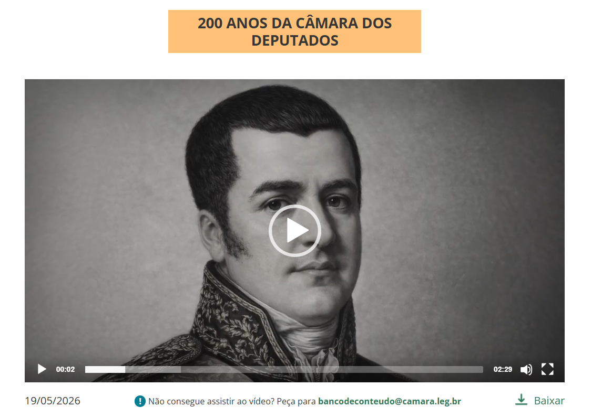

Fonte: elaborado pelo autor (2026)

- [x] Adicionar audiodescrição a vídeo pré-gravado, ou garantir que o áudio original baste para entender sem ver. (AA)

Resultado: Sim, o vídeo não apresenta audiodescrição mas o áudio original permite entender o contexto dos temas abordados.

- [ ] Adicionar legendas a transmissões ao vivo. (AA)

Resultado: Não cumpre, as transmissões ao vivo não contam com a funcionalidade de adicionar legendas.

- [ ] Adicionar transcrição completa (visual e sonora) a vídeos. (AAA, Recomendação)

Resultado: Não cumpre, os vídeos não possuem uma transcrição completa, tanto visual quanto sonora.

- [x] Adicionar janela de Libras, à direita e com bom contraste. (AAA, Recomendação)

Resultado: Sim, a janela de Libras está implementada de forma correta dentro do site.

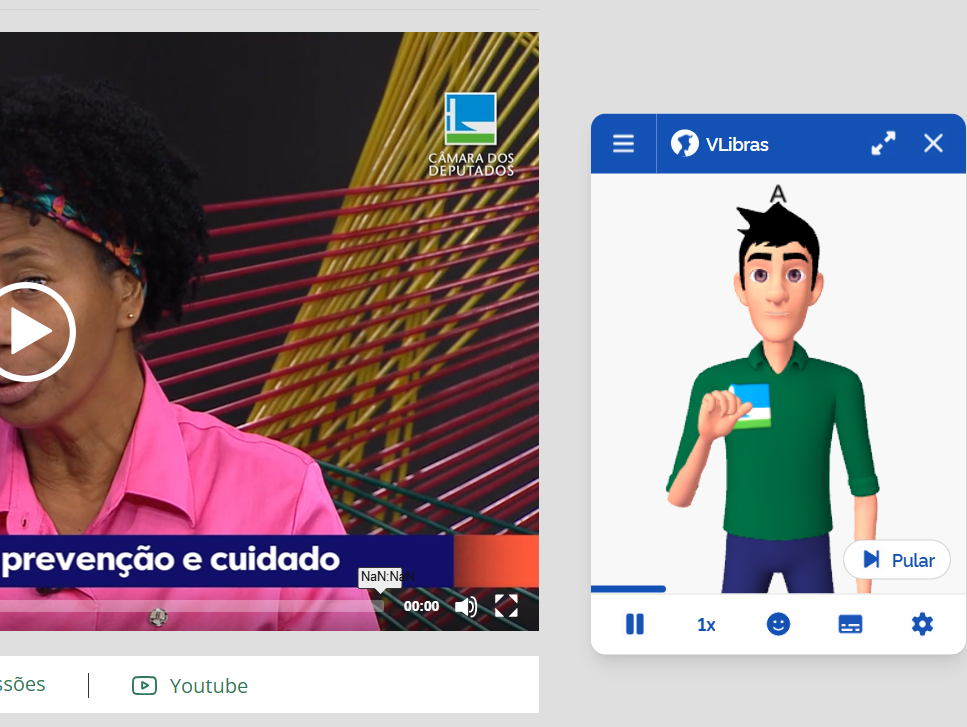

Fonte: elaborado pelo autor (2026)

- [ ] Oferecer audiodescrição estendida quando o vídeo não tem pausas suficientes. (AAA, Recomendação)

Resultado: Não cumpre, os vídeos disponíveis na página não contam com audiodescrição.

- [ ] Adicionar transcrição a áudio ao vivo. (AAA, Recomendação)

Resultado: Não cumpre, na seção da Rádio Câmara, o áudio ao vivo não possui transcrição.

- [x] Manter som de fundo baixo (20 dB abaixo da fala) ou permitir desligá-lo. (AAA, Recomendação)

Resultado: Sim, foi verificado que os áudios pré-gravados mantém um som de fundo baixo, permitindo escutar as vozes dos locutores de forma clara.

- [x] Acompanhar vídeos de um descritivo curto do conteúdo. (Boa prática)

Resultado: Sim, os vídeos são acompanhados de uma descrição curta que explica o tema principal abordado.

Fonte: elaborado pelo autor (2026)

## Arquivos e conteúdo de terceiros

- [x] Publicar arquivos acessíveis (PDF, DOCX com texto selecionável, títulos marcados, ordem de leitura correta). (Boa prática)

Resultado: Sim, arquivos encontrados dentro da página contém texto selecionável, títulos marcados e conservam a ordem de leitura ao momento de aplicar a leitura por voz. Para a função de leitura por voz, foi utilizado o navegador Microsoft Edge.

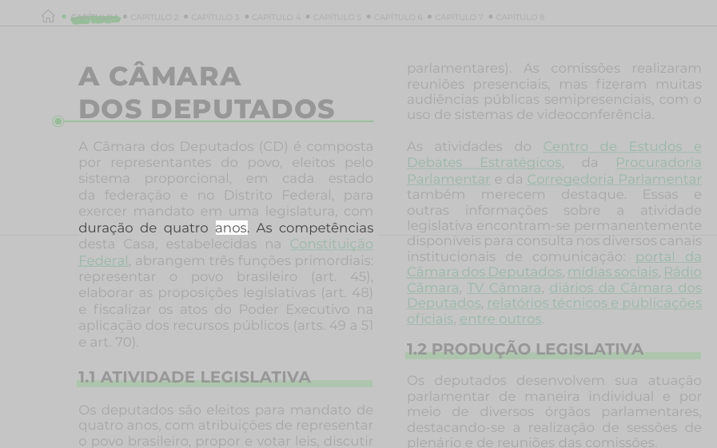

Fonte: elaborado pelo autor (2026)

- [x] Escolher conteúdo de terceiros acessível (vídeos e posts incorporados) ou avisar o usuário das barreiras. (Boa prática)

Resultado: Sim, dentro do site podemos encontrar conteúdo como vídeos de youtube, os quais disponibilizam legendas e serviço de Libras. Também incorpora no site acesso à transcrição e áudio do vídeo da sessão.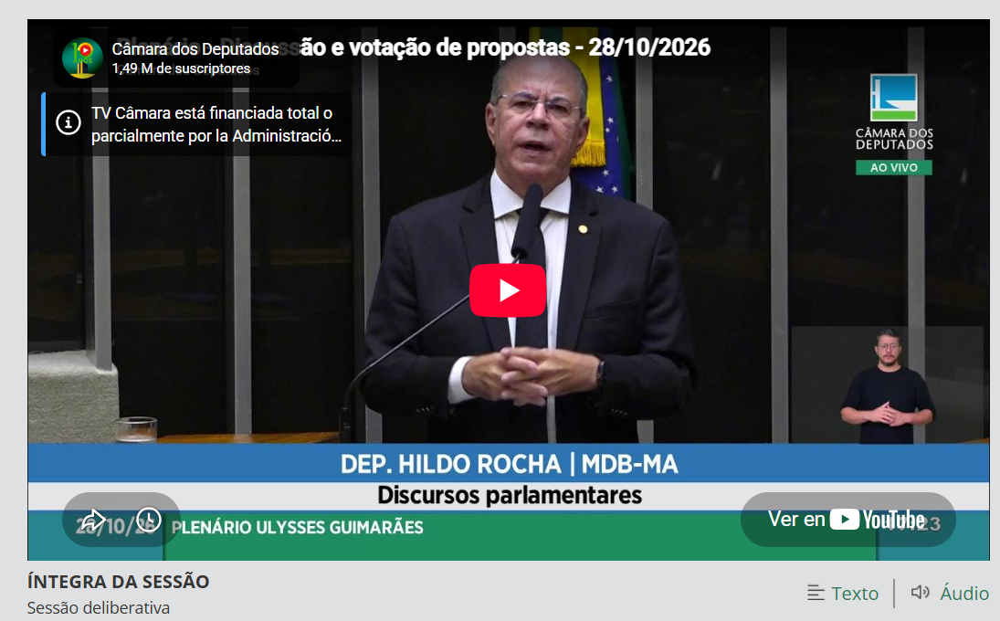

Fonte: elaborado pelo autor (2026)

- [x] Oferecer informações importantes em mais de um formato (texto + vídeo ou áudio). (Boa prática)

Resultado: Sim, o site oferece acesso à transcrição ou áudio de uma determinada sessão em formato de vídeo.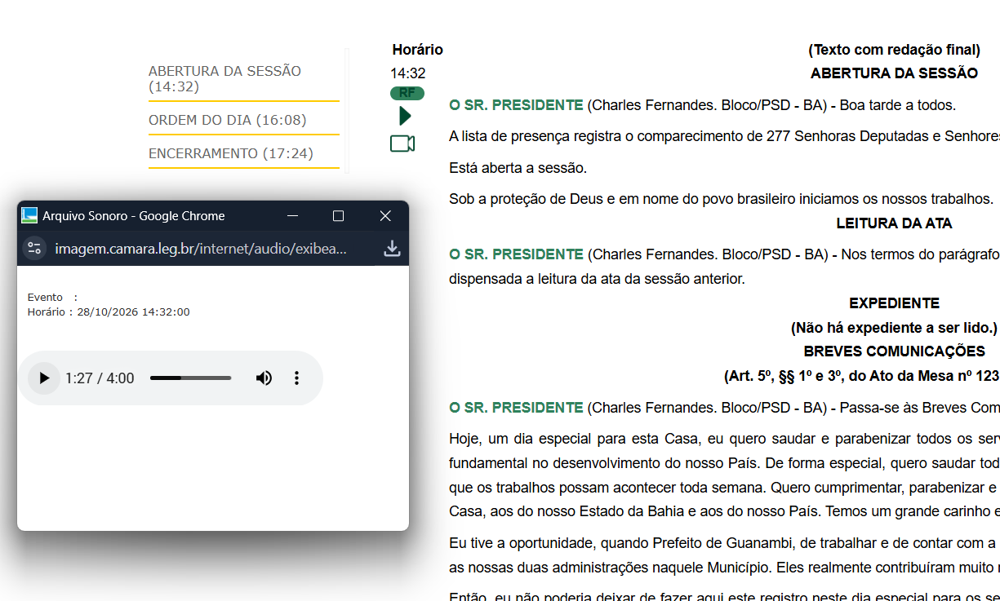

Fonte: elaborado pelo autor (2026)

Itens cumpridos: 16 de 26.