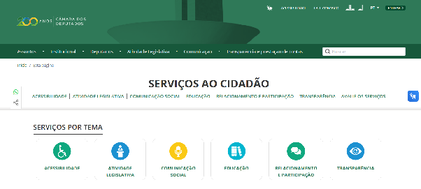

# Avaliação do Portal da Câmara dos Deputados

A seguinte avaliação será realizada como parte do projeto final da disciplina de Interação Humano Computador (IHC), seguindo os parâmetros propostos pelo [guia de acessibilidade](../guia/index.md) previamente construído pelo grupo. Os pontos a serem destacados dentro da estrutura do checklist são Desenvolvimento, Design, Geração de conteúdo e as Heurísticas de Nielsen.

Link do site a ser avaliado: [Câmara dos Deputados](https://www.camara.leg.br/)

Fonte: elaborado pelo autor (2026)

## Seções da avaliação

| Seção | O que verifica |
| --- | --- |
| [Desenvolvimento](desenvolvimento.md) | Teclado e foco, semântica do código, imagens, links, botões, formulários, tempo e modais |
| [Design](design.md) | Cor e contraste, tipografia, leiaute e animação |
| [Geração de Conteúdo](geracao-conteudo.md) | Textos, descrições de imagem, vídeo, áudio e arquivos |
| [Heurísticas de Nielsen](heuristicas.md) | As 10 heurísticas de usabilidade |
| [Resumo](resumo.md) | Contagem de itens cumpridos por seção |

Em cada item, a caixa marcada indica que o portal cumpre o critério. Caixa em branco indica que não cumpre, que cumpre só em parte, que não se aplica ou que não foi possível avaliar; o texto de **Resultado** explica qual é o caso.
