## Heurísticas de Nielsen

A seção de Heurísticas de Nielsen reúne as 10 heurísticas de usabilidade propostas por Jakob Nielsen e complementa o checklist de acessibilidade, avaliando principalmente se o site é fácil e agradável de usar. A análise é feita em conjunto pela equipe, a partir da execução de tarefas realistas no site, como acompanhar um projeto de lei ou encontrar o contato de um deputado. Isso permite relacionar os problemas de usabilidade encontrados às barreiras de acessibilidade identificadas nas outras seções.

- [x] 1. Visibilidade do status do sistema: o site mostra onde o usuário está (ex.: breadcrumbs, aba ativa) e dá retorno imediato e perceptível às ações (carregando, enviado, erro), tanto visualmente quanto para tecnologias assistivas (role="status" / aria-live).

Resultado: O site fornece informação útil para o usuário, mostrando a sua localização atual através das páginas no trilho de navegação, permitindo retornar para um ponto específico. Também foi verificado em uma página de formulário, que são apresentadas mensagens para o usuário em relação às ações realizadas.

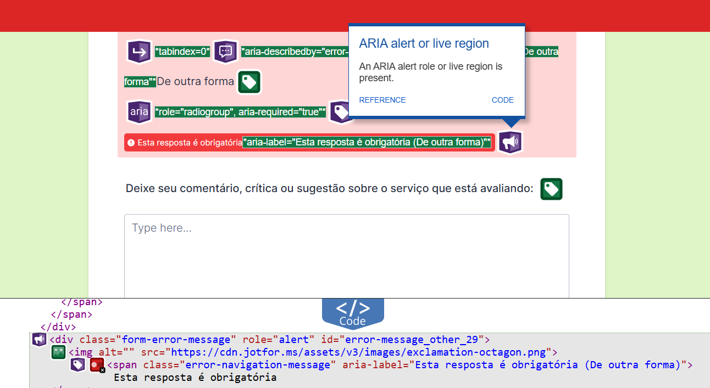

Fonte: elaborado pelo autor (2026)  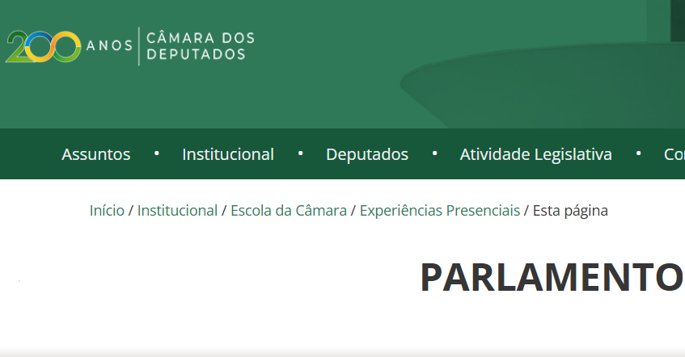

Fonte: elaborado pelo autor (2026)

- [x] 2. Correspondência entre o sistema e o mundo real: usa a linguagem do público cidadão, ícones reconhecíveis e ordem natural das informações, evitando jargões legislativos ou códigos técnicos de sistema sem explicação (ex.: "Erro 500").

Resultado: Sim, o sistema adota o uso de ícones relacionados a elementos da vida cotidiana do público geral, também utiliza linguagem natural e simples, além de fornecer explicação para palavras técnicas.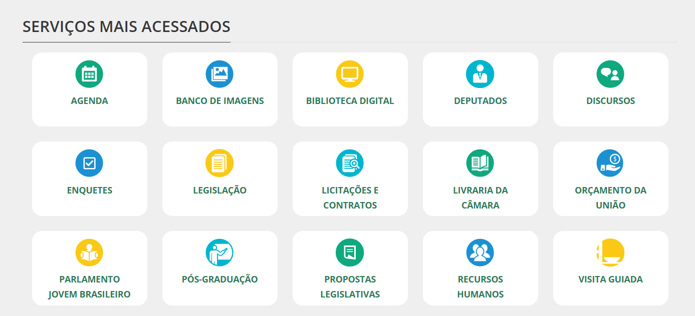

Fonte: elaborado pelo autor (2026)

- [x] 3. Controle e liberdade do usuário: há saídas claras para voltar, cancelar, desfazer ações e fechar modais, submenus e pop-ups (inclusive com a tecla Esc) sem perder o foco.

Resultado: Sim, o sistema conta com saídas para voltar, cancelar, desfazer ações e fechar modais, mas é importante considerar que a tecla Esc não ativa nenhuma ação na página.

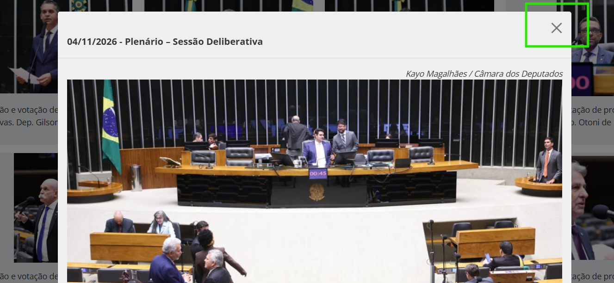

Fonte: elaborado pelo autor (2026)

- [x] 4. Consistência e padrões: funções iguais têm o mesmo nome, cor, ícone e posição em todas as telas do portal, mantendo o menu principal e a busca padronizados e seguindo convenções da web.

Resultado: Sim, ao observar o visual das páginas dentro do site, é possível verificar que elas mantêm o mesmo padrão de cores, ícones e o logotipo, botões, o trilho de navegação e o campo de busca conservam a posição, cumprindo com as práticas acordadas em esta heurística.

- [x] 5. Prevenção de erros: o formato esperado é indicado antes do preenchimento, os dados são validados com máscaras/restrições, ações destrutivas pedem confirmação e a interface previne tanto deslizes (cliques acidentais) quanto enganos (instruções confusas), sem apagar os dados já preenchidos caso ocorra erro em um campo.

Resultado: Sim, para validar utilizamos como referência o formulário de “Avalie os serviços”, onde revisamos os campos a serem preenchidos enquanto verificamos que aparecem mensagens informativas de erro ou de sucesso, existem botões para enviar, refazer ou salvar para continuar depois e os campos obrigatórios são identificados por meio de asteriscos.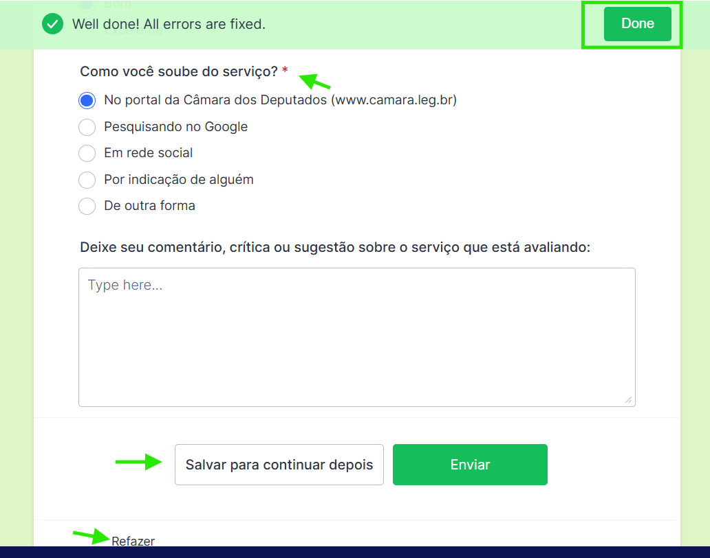

Fonte: elaborado pelo autor (2026)

- [x] 6. Reconhecimento em vez de memorização: opções, regras de preenchimento e rótulos ficam permanentemente visíveis próximos aos campos (<label>, sugestões de busca) e o usuário não precisa lembrar informações entre telas.

Resultado: Sim, foram avaliados os campos de busca da seção de deputados e de propostas legislativas onde verificamos que são mostradas corretamente as opções disponíveis, regras e rótulos facilitando o preenchimento para os usuários. Na seção de deputados, no campo de nome está disponível uma lista com os nomes dos deputados. Na seção de propostas legislativas, o usuário tem acesso aos tipos de proposição mais pesquisados (PEC, PLP, PL), entre outros.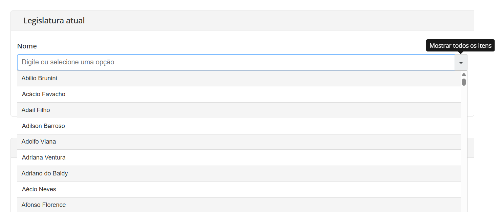

Fonte: elaborado pelo autor (2026)

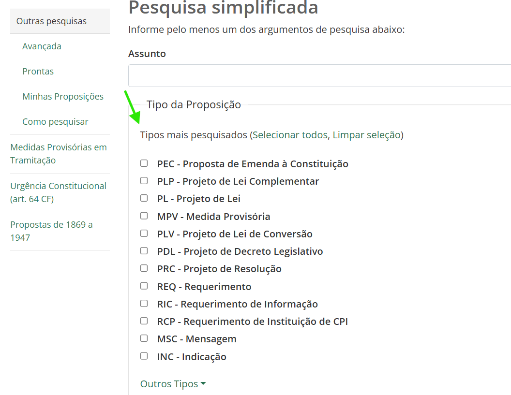

Fonte: elaborado pelo autor (2026)

- [x] 7. Flexibilidade e eficiência de uso: oferece caminhos claros e guiados para usuários iniciantes e disponibiliza aceleradores funcionais (atalhos de teclado accesskey, link "Pular para o conteúdo", busca rápida e preenchimento automático) para usuários experientes, funcionando com teclado, toque e tecnologias assistivas.

Resultado: Sim, o site oferece diferentes formas de navegar pelo conteúdo e as páginas existentes, respondendo às necessidades de usuários iniciantes e experientes. É possível navegar através de atalhos do teclado especificados na seção de acessibilidade (ALT, SHIFT e combinação de teclas numéricas), além disso há presença tanto de busca rápida quanto de buscas avançadas com opções de filtros e seleção de dados. Um ponto a considerar é que a busca não oferece sugestões ao digitar.

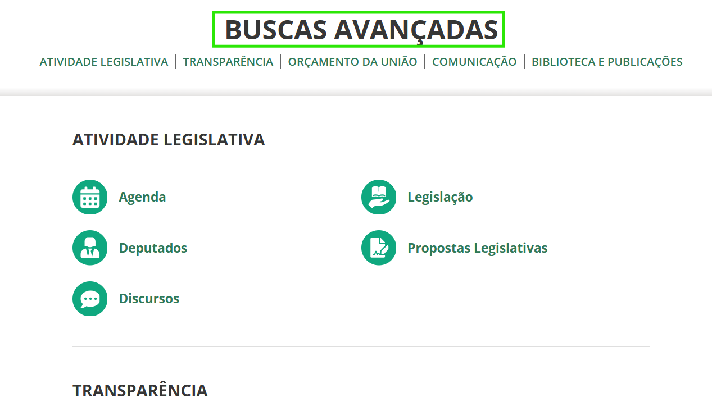

Fonte: elaborado pelo autor (2026)

- [x] 8. Estética e design minimalista: não há informação irrelevante, excesso de banners ou pop-ups disputando atenção com os serviços principais, mantendo hierarquia visual clara e baixa carga cognitiva.

Resultado: Sim, após revisão das páginas e seções do sistema, se considerou que as informações disponíveis são relevantes no contexto do site, o visual mantém a organização dos elementos, evitando excesso de conteúdo em um determinado espaço.

- [x] 9. Ajudar o usuário a reconhecer, diagnosticar e recuperar-se de erros: mensagens em linguagem simples indicam exatamente o campo com problema, dizem a causa sem códigos técnicos e sugerem como corrigir (ex.: "Use o formato DD/MM/AAAA"), sem perder o que foi preenchido.

Resultado: Sim, o sistema fornece mensagens que permitem informar para o usuário qual o resultado de uma determinada ação, fornecendo sugestão de correção de erro em caso de que as ações feitas pelo usuário não forem válidas, como visto no exemplo acrescentado dentro da primeira heurística.

- [x] 10. Ajuda e documentação: ajuda, FAQ, glossário legislativo, página de acessibilidade ou contato são fáceis de achar, ficam sempre no mesmo lugar e dão passos concretos e dicas contextuais.

Resultado: Sim, dentro do site podemos encontrar uma seção para perguntas frequentes e áreas clicáveis para acessar às redes sociais, número de telefone, atendimento presencial e online, na seção superior de uma página está presente o botão para acessar diretamente a página de acessibilidade. Apesar de não possuir acesso rápido, há presença de glossários relacionados a terminologias de acessibilidade e dicionário de Libras, também é disponibilizado um glossário específico para termos legislativos.

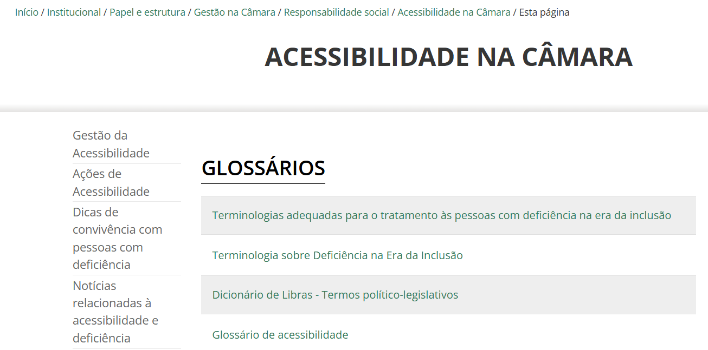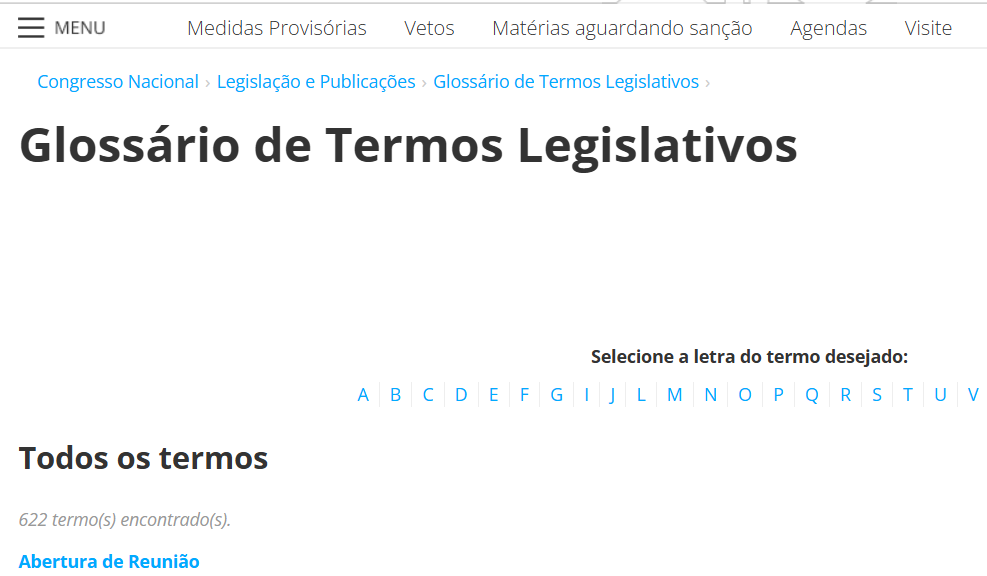

Fonte: elaborado pelo autor (2026)                   Fonte: elaborado pelo autor (2026)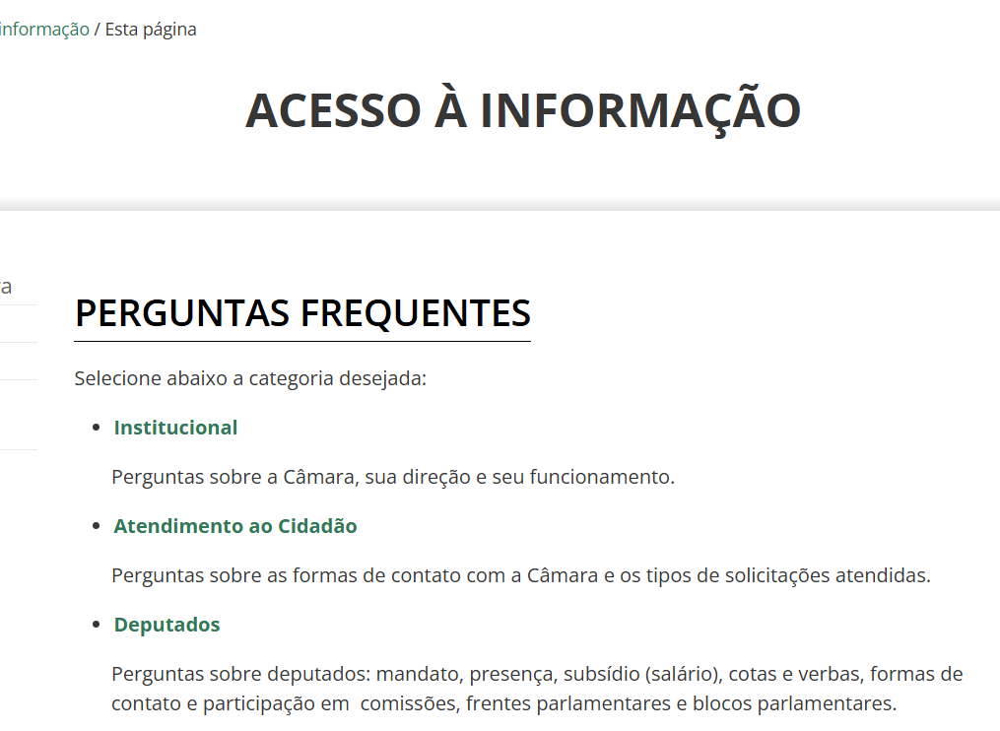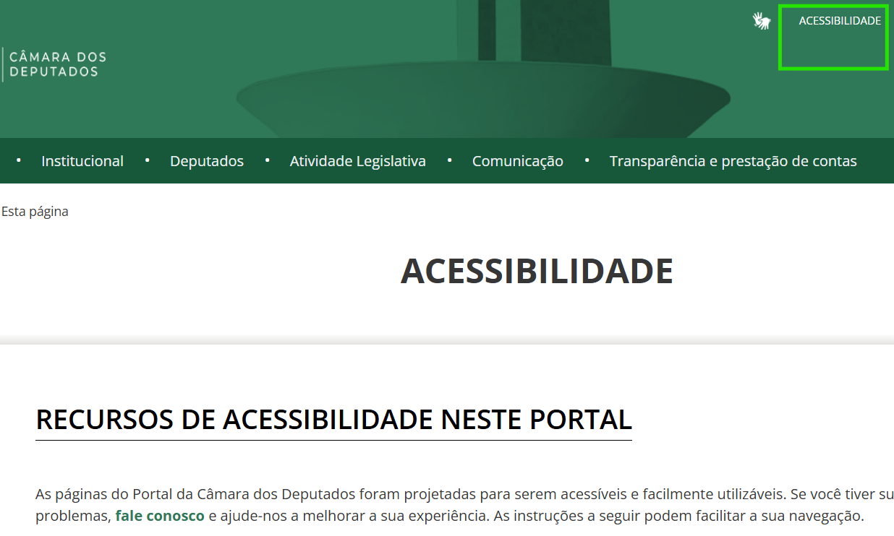

Fonte: elaborado pelo autor (2026)                   Fonte: elaborado pelo autor (2026)

Itens cumpridos: 10 de 10.
